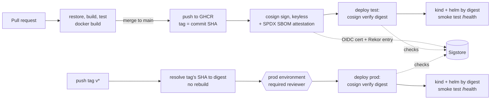

# secure-delivery-pipeline

[](https://github.com/ruelbelmonte/secure-delivery-pipeline/actions/workflows/ci.yml)
[](https://github.com/ruelbelmonte/secure-delivery-pipeline/actions/workflows/security.yml)

A supply-chain-hardened CI/CD pipeline on GitHub Actions for a small .NET 10 API.
Every image is signed without long-lived keys, carries an SBOM attestation, is
verified before each deploy, and is deployed and promoted by digest only.

It runs end to end on a free personal GitHub account. No cloud account is needed:
deploys go to a throwaway [kind](https://kind.sigs.k8s.io/) cluster inside the runner.
An optional AWS stack shows the same ideas for Terraform.

## Pipeline



| Workflow | Trigger | What it does |
|---|---|---|
| [`ci.yml`](.github/workflows/ci.yml) | PR, push to `main` | Locked restore, build, test with Cobertura coverage, image build. On `main`: push `ghcr.io/<owner>/<repo>:<sha>`, sign, attest SBOM, deploy to `test`. |
| [`deploy.yml`](.github/workflows/deploy.yml) | `workflow_call` (`environment`, `image-digest`) | Verify signature and SBOM attestation against the expected identity, create kind cluster, `helm upgrade --install` by digest, wait for rollout, smoke-test `/health`. |
| [`release.yml`](.github/workflows/release.yml) | push of `v*` tag | Resolve the tagged commit's image digest and call `deploy.yml` for `prod`. |
| [`security.yml`](.github/workflows/security.yml) | PR, push to `main`, Mondays 06:23 UTC | Trivy image scan, CodeQL (C#), gitleaks, dependency review on PRs. The weekly run rescans the published `main` image. |
| [`terraform-plan.yml`](.github/workflows/terraform-plan.yml) | PR / push touching `infra/` | Plan with a read-only role and upload the saved plan file. Skips if AWS isn't configured. |
| [`terraform-apply.yml`](.github/workflows/terraform-apply.yml) | after a successful `main` plan | Behind the `prod` gate, download and apply that exact plan file. Skips if AWS isn't configured. |

## Why each control exists

**Workflow hardening**
- **`permissions: {}` at the top, grants per job.** A compromised step can only use the token scopes its own job needed.
- **`id-token: write` only on `publish` and the Terraform jobs.** Only those jobs can mint OIDC tokens to sign images or assume an AWS role.
- **Actions pinned to full commit SHAs.** Tags are mutable. In March 2026 an attacker force-pushed 76 of 77 `aquasecurity/trivy-action` tags to credential-stealing code ([GHSA-69fq-xp46-6x23](https://github.com/aquasecurity/trivy/security/advisories/GHSA-69fq-xp46-6x23)). A SHA pin isn't affected by that kind of tag rewrite.
- **Dependabot with a 7-day cooldown.** Pins still get updated, but a release isn't adopted until it has been public for a week, which is usually long enough for a malicious one to be caught.
- **`persist-credentials: false` on checkout.** The job token isn't left in `.git/config` for later steps to read.
- **Untrusted values go through `env:`, never inline `${{ }}` in `run:`.** This blocks shell injection through crafted inputs.

**Build**
- **NuGet lock files with `--locked-mode`.** Restore fails if the dependency graph drifts from what was reviewed.
- **Base images pinned by digest.** The build doesn't silently pick up a changed upstream image. Dependabot proposes digest bumps.
- **Chiseled runtime image, non-root UID 1654.** No shell or package manager, so there is less to exploit and less to patch.
- **Pod hardening in the chart.** `runAsNonRoot`, read-only root filesystem, all capabilities dropped, `RuntimeDefault` seccomp, no service account token.

**Sign, verify, deploy**
- **Keyless cosign signing.** The signing certificate is bound to this repo's `ci.yml` on `main` through GitHub OIDC, so there's no signing key to leak or rotate.
- **SPDX SBOM attestation.** A signed, machine-readable inventory of what's in the image, attached to the image digest.
- **`cosign verify` before every deploy.** It checks the certificate identity (`.../ci.yml@refs/heads/main`) and the issuer, not just "some valid signature". A deploy fails closed if either check fails.
- **Deploy by digest; the chart rejects anything else.** A tag can be re-pointed after verification. A digest can't.
- **Promote, don't rebuild.** `prod` runs the exact bytes that were verified and tested in `test`.
- **`prod` environment with a required reviewer.** A person approves each production deploy and Terraform apply.
- **`concurrency` with `cancel-in-progress: false`.** A running deploy is never killed half-way.

**Scanning**
- **Trivy, failing on fixable HIGH/CRITICAL.** Blocks known-vulnerable images on PRs and `main`. Findings go to code scanning.
- **Weekly rescan of the published image.** New CVEs get disclosed against images that were clean when built.
- **CodeQL for C#.** Static analysis for common vulnerability classes in the application code.
- **gitleaks over full history.** Catches committed secrets, including in older commits.
- **Dependency review on PRs.** Blocks a PR that adds a dependency with a known high-severity advisory.

**Terraform (optional)**
- **GitHub OIDC to AWS, two roles.** No AWS keys are stored. PRs only get a role that can read state and bucket configuration, and it can't take the state lock. The write role's trust policy requires both `sub` = `repo:<owner>/<repo>:environment:prod` and `job_workflow_ref` = `terraform-apply.yml@refs/heads/main`, so no other workflow that targets `prod` can assume it.
- **Apply the saved plan file.** What the reviewer approves is what gets applied. Terraform rejects the plan if state changed in between.
- **`workflow_run` guards.** Apply only runs after a successful *push* to `main` in this repo. Fork PRs can't reach it, even from a branch named `main`.

## Threat model

| Threat | Example | Control that stops it |
|---|---|---|
| Tampered image | Someone with registry write access pushes a modified image | `deploy.yml` runs `cosign verify` with the expected identity and issuer and fails. The tampered digest has no signature from `ci.yml@refs/heads/main`. |
| Compromised tag | An image tag (or `v*` git tag) is re-pointed to different content | Deploys use a digest resolved once and verified. The chart refuses tags. A git tag on an unbuilt or unsigned commit has no digest to resolve, or fails verification. |
| Compromised third-party action | Action tags rewritten to malware (the Trivy incident above) | Actions pinned to commit SHAs, plus a 7-day Dependabot cooldown before a new SHA is adopted. |
| Leaked credentials | A token from a workflow log or a fork PR is exfiltrated | No long-lived credentials exist. GHCR uses the per-job `GITHUB_TOKEN`, signing uses short-lived Fulcio certificates, and AWS uses STS sessions of 1 hour or less. Write access to AWS needs the `prod` environment, which needs reviewer approval. |
| Vulnerable dependency | A NuGet package or base-image layer has a new CVE | Dependency review on PRs, Trivy on PRs and `main`, the weekly rescan of the published image, and Dependabot updates. |
| Malicious PR | A PR tries to sign images, push, or apply Terraform | PR jobs get `contents: read` only. Publish, sign and deploy run only on `main`. Fork PRs get no OIDC token, and apply requires a `push` event from this repo. |

## Fork and run it

1. **Fork** this repo and enable Actions on the fork (Actions tab → enable). Then turn on
   Settings → Advanced Security → **Dependabot alerts**, which also enables the dependency graph.
   Dependency review fails with "not supported on this repository" until it's on.
2. **Create the `prod` environment:** Settings → Environments → New environment → `prod`.
   - **Required reviewers:** add yourself (and anyone else who should approve).
   - **Deployment branches and tags:** "Selected branches and tags". Add branch `main` (for Terraform apply) and tag pattern `v*` (for releases).
   - The `test` environment is created automatically on the first deploy.
3. **Push a commit to `main`.** `ci` builds, pushes, signs and attests the image, then deploys it to `test`. The GHCR package is created private and linked to the repo. The workflows pull it with `GITHUB_TOKEN`.
4. **Release:** tag a `main` commit whose `ci` run succeeded, then approve the `prod` deployment in the Actions run.
   ```sh
   git tag v0.1.0 <sha-on-main>
   git push origin v0.1.0
   ```
5. **Verify an image yourself** (after `docker login ghcr.io`, or make the package public):
   ```sh
   cosign verify ghcr.io/<owner>/secure-delivery-pipeline@sha256:<digest> \
     --certificate-identity "https://github.com/<owner>/secure-delivery-pipeline/.github/workflows/ci.yml@refs/heads/main" \
     --certificate-oidc-issuer https://token.actions.githubusercontent.com
   ```

Code scanning, the dependency graph and environment reviewers are free for public repositories.
If the fork is owned by an organization rather than a personal account, `gitleaks-action` needs a
free `GITLEAKS_LICENSE` secret.

### Optional: AWS

Without AWS, the Terraform jobs show as skipped and the repo stays green. To enable them:

```sh
cd infra/bootstrap
terraform init
terraform apply -var github_repository=<owner>/secure-delivery-pipeline
# Add -var create_oidc_provider=false if the account already has GitHub's OIDC provider.

for v in AWS_PLAN_ROLE_ARN AWS_ROLE_ARN TF_STATE_BUCKET AWS_REGION; do
  gh variable set "$v" --body "$(terraform output -raw "$v")"
done
```

Run bootstrap once, locally, with admin credentials. It creates the OIDC provider, a versioned and
encrypted state bucket, and the two roles. After that, a change under `infra/` triggers a plan on the PR.
After merge, an apply waits for `prod` approval. S3 usage is billed to your AWS account. For two
near-empty buckets this is usually negligible, but check your own pricing.

## Run it locally

```sh
dotnet test --coverage --coverage-output-format cobertura
docker build -t weather-api:local .
docker run --rm -p 8080:8080 --read-only weather-api:local   # GET /health, GET /weather
helm lint deploy/chart --set image.digest=sha256:$(printf 'a%.0s' {1..64})
terraform -chdir=infra init -backend=false && terraform -chdir=infra validate
```

## Limitations

These are deliberate scope limits, and they matter if you reuse the design:

- **Verification happens in the pipeline, not the cluster.** Anyone with direct cluster access could still run an unsigned image. In a real cluster, enforce signatures at admission as well, for example with Sigstore policy-controller or Kyverno.
- **kind clusters are ephemeral.** `test` and `prod` here show the gates and the promotion flow. They are not long-lived environments.
- **GitHub concurrency keeps at most one pending run per group.** A running deploy is never cancelled, but if two more queue up behind it, the older pending one is replaced by the newer one.
- **Signatures are public.** Keyless signing writes an entry to the public Rekor transparency log, including the repo and workflow identity. That's fine for a public repo, but consider it for private ones.
- **The saved Terraform plan is a workflow artifact.** Only `main` plans are uploaded, and they're kept for 3 days. On a public repo they can still be downloaded by anyone with read access. This stack has no secret values, but a plan for a real stack can contain them. Encrypt the plan, or keep it in a private bucket, before reusing this design.
- **The `prod` environment is configured by hand.** Its reviewers and branch/tag rules are part of the trust boundary but live in repo settings, not code. Manage them as code (for example the Terraform GitHub provider) in a real setup.
- **Trivy runs with `ignore-unfixed`.** HIGH/CRITICAL CVEs with no available fix are reported, but they don't fail the build.
- **No compliance claims.** These controls follow common supply-chain guidance. They aren't a certification or an attestation of compliance with any standard or regulation.

## Layout

```
.github/workflows/   ci, deploy, release, security, terraform-plan, terraform-apply
src/WeatherApi/      .NET 10 minimal API: GET /health, GET /weather (synthetic data)
tests/               xUnit v3 tests on Microsoft.Testing.Platform
deploy/chart/        Helm chart, digest-only
infra/               optional S3 stack; infra/bootstrap for OIDC provider, roles, state bucket
```

## License

[MIT](LICENSE)
